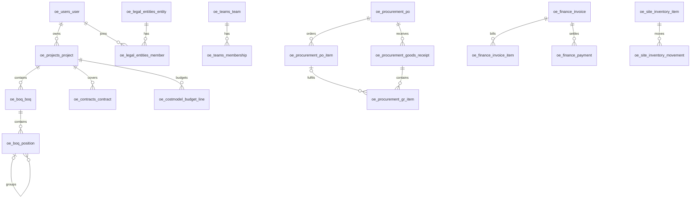

# Kobci Construction ERP

## Cost-control milestone

A project manager can approve an imported BOQ, a purchaser can issue an approved order, and a finance user can reconcile a partial delivery, supplier costs and a signed client contract. In **Finance → Budgets**, enter each line's forecast final cost. Open **Finance → Project cost control** to see the live cost position, forecast profit and margin. The report has an English/Soomaali selector that remembers the user's choice in the browser.

The verified scope is direct project procurement on a fixed-price job. The financial report uses the existing PostgreSQL database and authentication. Running it under the upstream open-source licence requires no software subscription. Hosting, backups and support can incur costs.

## Architecture and feature assessment

| Area | Existing implementation and reuse | Remaining acceptance work |
| --- | --- | --- |
| Runtime | FastAPI, SQLAlchemy, PostgreSQL and Alembic. The desktop runtime can start an embedded PostgreSQL server. React 18, TypeScript, Vite, Tailwind, TanStack Query and i18next serve the UI. | Qualify a Windows build of this fork and restore a representative backup on a clean machine. |
| Companies and projects | Legal entities, functional currencies, entity members, teams, branches, project settings and client contracts exist. Project owners, project team members and entity members can have project access. | Establish a strict company-admin boundary across shared suppliers, catalogues, attachments, reports and exports. Platform admins have global privileges. Company membership currently adds access to existing project grants. |
| Estimating | BOQ position hierarchy, quantities, unit rates, resource build-ups, Excel import/export, approval, estimate revisions and cost-model work packages exist. BOQ approval now freezes Finance's first allocation per bill. | Sign off PlanSwift mappings against a surveyor's real export. Reconcile contingencies, markups and alternatives against company estimating policy. |
| Procurement | Requisitions, tendering, contacts, PO items, approvals, goods receipts, payable invoices and subcontract applications exist. Finance already tracks source documents and shared tender awards. | Qualify the complete RFQ–comparison–award journey with local suppliers and test amended contracts and multi-line invoice matching. |
| Finance | Project budgets, change orders, cost recognition, payments, cost-value reconciliation, cash flow, ledger and exports exist. This milestone adds a reconciled project report with per-currency forecasts. | Reconcile indirect costs, direct payroll, stock consumption and client variations across all posting paths. Verify work-package, section and category reports on a representative job. |
| Materials and labour | Site inventory has location, item and movement tables. Field time, payroll, subcontractors and cost-model position actuals track work and cost. | Central warehouse receipts belong to inventory until issue to a project. Complete and verify issue, return, waste, labour and payroll posting into this report before using it for these jobs. |
| Schedule and site | Schedule, dependencies, CPM, progress, daily diary and site supervision modules exist. | Validate a configurable Friday-off calendar, building templates, measured productivity and local mobile submission/approval flows. |
| FX and language | FX policies, manual quotes and rate sets exist. Projects and legal entities can hold USD or the local SLS identifier. The cost-control report and its feedback states are bilingual. | Provide historical base-currency reporting across transactions, translate the wider application and exports, and have Somaliland practitioners review the terminology. |
| Operations | Existing pytest, Vitest, Playwright, security checks, Docker configurations, signed-release and SBOM workflows remain available. | Full repository CI, performance, attachment review, backup restore, Windows installation and commercial UAT require release evidence. |

## Database relationships

The full diagram was generated from the public schema of the disposable PostgreSQL integration database using its table catalogue and foreign-key constraints. It contains 973 tables and 1,209 referencing-column relationships. Render the DOT file with Graphviz, for example `dot -Tsvg docs/kobci/schema.dot -o schema.svg`. The diagram represents the tested startup schema. A long-lived deployment can have extra migration-managed columns or optional modules. [Full schema diagram](schema.dot)

The physical relationships below are the subset relevant to the report.



Finance also uses application-managed links. Budget rows contain a project ID and a WBS/category key. PO and invoice project IDs, invoice-to-order references and per-BOQ budget contributions are resolved by the services. The report uses those services and a project-scoped contract query. Approval provenance and the frozen project conversion are stored in existing JSON metadata. **No database migration is required for this milestone.** Existing baselines retain the evidence available when they were created.

## Accounting and currency

- **Approval.** The first allocation from an original BOQ is written in the lock transaction. Only included leaf positions contribute. Distinct original bills can contribute to the same WBS. Replaying approval or changing an exchange rate preserves the allocation. Scenarios, revision copies and variation bills go through change control. Use the approved change-order path for budget revisions. The report shows current budget minus original as recorded changes. Manually entered budget lines retain the existing editor workflow.
- **Actual and open commitments.** The report reads Finance's source-document cost position. For a linked PO, recognized cost is the larger of confirmed net deliveries and settled net invoices. Outstanding commitment is the positive balance of the order or invoiced amount, whichever is greater, after recognized cost. Against an active subcontract, settled amounts draw down its commitment. An independent payable enters commitments when invoiced and enters recognized cost as it settles. A payable on an approved application replaces that application according to Finance's existing rules. VAT-inclusive cash payments and refunds are presented separately.
- **Forecast.** For each budget line, future uncommitted work is the positive remainder of the entered final forecast after the line's recognized cost and open commitments. Sum these remainders in the same currency. Forecast final cost equals recognized cost plus open commitments plus that sum. Variance equals current budget minus forecast final cost. A missing line forecast, an unknown currency or unreconciled allocations withhold the forecast. The upstream budget model uses zero as its unset forecast, so it cannot distinguish an intentionally zero final forecast.
- **Revenue and profit.** The original signed value is frozen by Contracts. Current contract value includes amendments posted to it. Their difference is displayed as changes since signing. Profit equals current contract value minus forecast final cost. Margin is profit divided by positive current contract value. The report withholds overall profit for mixed currencies, unresolved duplicate subcontracts, incomplete forecasts and ambiguous client contracts. The first supported contract is a single signed, top-level fixed-price client agreement in the cost currency. Cash receipts, a project's descriptive contract field and draft contract amounts do not enter profit.
- **Currency.** USD is the US dollar. SLS is this fork's three-letter local accounting identifier for the Somaliland shilling, displayed as **SL SH**. It is distinct from ISO SOS. The existing two-decimal Finance storage is used for SLS, including aggregated accounting values. Select the currency under the project's settings and the company's functional currency under Legal Entities. No default price, productivity benchmark or USD/SLS exchange rate ships with this change.
- **Historical conversion.** For a new foreign-priced BOQ baseline, supply a valid project rate measured in base units per one unit of foreign currency. The BOQ engine applies position/resource rates. A missing or invalid rate blocks approval. The baseline records the base currency, rates used, configuration source, approving user and approval timestamp. A provider's publication date and the approval date are different concepts. Transaction-wide dated FX evidence and multi-currency profit require further integration with FX rate sets. Original-currency cost rows remain usable without a common rate.

### Worked acceptance example

The following is **demonstration data**. The same scenario runs independently in USD and SLS. The illustrative amounts describe neither local prices nor an exchange rate.

| Event | Expected result in the selected currency |
| --- | ---: |
| Import 20,000 units at 5.00 and lock the estimate | 100,000.00 original budget |
| Approve an order for 50,000.00 net | 50,000.00 outstanding |
| Confirm receipt of 80% before payment | 40,000.00 recognized, 10,000.00 outstanding, 0.00 paid |
| Enter a final line forecast of 60,000.25 | 10,000.25 future uncommitted work, 39,999.75 favourable variance |
| Sign a client contract for 80,000.25 | 20,000.00 forecast profit, 25.00% margin |

The same integration suite checks a linked invoice and payment, partial receipt, paid subcontract application, no second budget on replay, foreign-currency approval with historical rate preservation, and project access.

## HTTP interface and permissions

`GET /api/v1/finance/project-cost-report/?project_id=<uuid>` requires authentication, project access, `finance.read` and `contracts.read`. The project ID is required. A project outside the caller's scope returns 404. The response is read-only and monetary values are decimal strings. Missing values are JSON null. `currencies[]` contains budget, recognition, commitments, cash and forecast fields plus `forecast_status`. Contract value, changes, profit, margin and reconciliation status are project-level fields. The FastAPI response model supplies the field-level OpenAPI schema.

| Action | Server permission or boundary |
| --- | --- |
| Edit draft estimates | Existing BOQ edit rights and project access |
| Lock, unlock or create a budget from a locked BOQ | `boq.approve_baseline`, manager by default, and project access |
| Enter a line forecast | `finance.update` and access to that budget's project |
| Approve a purchase order | `procurement.approve`, manager by default |
| Sign the client contract | `contracts.sign`, manager by default |
| Approve or pay a supplier invoice | `finance.approve` or `finance.pay`, manager by default |
| Read the report | Both read permissions and access through project ownership, a team, entity membership or the platform-admin role |

The organization test creates two legal entities with SLS, assigns separate projects and viewers, and checks positive access and denial of cross-company reads and financial writes. The test is specific to these routes. Instance-wide shared registries and delegated company administration still require an isolation review.

## Working glossary

| English | Somali |
| --- | --- |
| Project cost control | Xakamaynta kharashaadka mashruuca |
| Original budget | Miisaaniyaddii asalka ahayd |
| Current budget | Miisaaniyadda hadda |
| Forecast final cost | Wadarta kharashka la filayo |
| Forecast project profit | Faa’iidada mashruuca ee la filayo |
| Report language | Luqadda warbixinta |

The report's full dictionary lives in `frontend/src/features/finance/costReportLocale.ts`. Switching language preserves the current project and loaded report. Broader Somali navigation and transaction forms are still pending.

## Running and verifying locally

Use the feature branch in a separate checkout and an isolated development database. PostgreSQL is free to self-host. For a Windows development workstation with Python 3.12+, Node 24 and Docker Desktop or compatible Docker tooling, the following PowerShell commands build the existing Compose quickstart from this checkout. Supply locally generated secrets through the process environment.

```powershell
$env:POSTGRES_PASSWORD = (python -c "import secrets; print(secrets.token_hex(32))")
$env:JWT_SECRET = (python -c "import secrets; print(secrets.token_hex(48))")
$env:OE_BIND = "127.0.0.1"
docker compose -p kobci-local -f docker-compose.quickstart.yml up --build -d
docker compose -p kobci-local -f docker-compose.quickstart.yml ps
```

Open `http://127.0.0.1:8080`. Keep the secret values for this local installation in your secret store. Reuse them for later starts against the same volume. Stop the local application with `docker compose -p kobci-local -f docker-compose.quickstart.yml stop`. Check Docker Desktop's licence for your organization's use. Review the security findings below before hosting or distributing the software.

For source development, follow the repository's setup instructions and use a clean QA environment. The PostgreSQL test harness provisions its own test database. [Developer guide](../../DEVELOPING.md) · [Deployment configurations](../../deploy) · [Backup monitoring](../backup-monitoring.md)

```powershell
cd backend
py -3.12 -m venv .venv
.\.venv\Scripts\python -m pip install -e ".[server,dev]"
.\.venv\Scripts\python -m pytest tests/integration/test_finance_project_cost_position.py tests/unit/test_finance_cost_position.py -q
cd ../frontend
npm ci
npm test -- --run src/features/finance/__tests__/ProjectCostReport.test.tsx src/features/finance/__tests__/financeCostPositionCards.test.tsx src/features/finance/__tests__/tabFromUrl.test.tsx
npm run typecheck
```

### Verification record

| Check | Result |
| --- | --- |
| Source-document cost recognition, budget allocation, variance and metadata unit tests | 55 passed |
| Project finance HTTP scenarios on disposable PostgreSQL, including USD, SL SH, historical FX, permissions and two separate companies | 16 passed |
| FX conversion/validation, inventory, field-time payroll export, schedule progress/CPM, booking export and three BOQ import routes | 97 passed |
| Contract PDF/Excel output, legal-entity visibility, payroll rules and FX policy access | 78 passed |
| Finance tab navigation, existing dashboard cards and bilingual cost report | 16 Vitest checks passed |
| Responsive report | Chromium rendered both languages at 360, 768 and 1,280 pixels. The browser layout check used a demonstration API response. |
| Local deployment configuration | Compose configuration validated with loopback binding. Windows installer and production deployment remain pending. |

The scope of the tests is recorded here so an operator can distinguish a working pilot from a commercial release. Tests used isolated Linux QA infrastructure. PDF and Excel checks exercised the existing contract exports. The new cost report currently renders in the application.

## Security, dependencies and licence

**A shared instance still exposes company directory information across company boundaries.** The upstream Legal Entities directory lists companies and member information for authenticated users without filtering these reads by company membership. The new cost report enforces project scope. Independent companies should use separate instances until the company directory and other shared surfaces enforce tenant isolation.

The desktop lockfile contains two packages with open advisories. `python-jose==3.5.0` has a **critical** advisory concerning algorithm validation with DER-encoded public keys. `ecdsa==0.19.2` has a **high** advisory concerning P-256 timing. The project uses python-jose in JWT and OIDC code. Both advisories listed no patched version at review time. Deployment-specific exploitability is unverified. Treat desktop distribution and public hosting as blocked pending an authentication dependency review and verification of the affected signing and decoding paths. [python-jose advisory](https://github.com/advisories/GHSA-3qf3-8w2g-rqmx) · [ecdsa advisory](https://github.com/advisories/GHSA-wj6h-64fc-37mp)

The npm audit of the production dependency tree reported zero known vulnerabilities. That check covers the registry's published advisories for the lockfile. It does not certify the installer, container image, operating system, Python environment or application authorization. This milestone adds no runtime dependency. Existing CI includes dependency review, CodeQL, secret scanning, SBOM generation and release signing.

The upstream release carries AGPL-3.0-or-later and upstream copyright notices. A commercial service can use the AGPL route. For a modified network service, provide an accessible, prominent offer of the complete corresponding source to users who interact with the running version, free of charge. Publish the exact served revision, its licence and notices, modifications, and required build and installation scripts. When conveying binaries, meet the AGPL's applicable source-delivery requirements. Keep third-party notices and check data, fonts, marks and optional components independently. The upstream commercial agreement template is a separate licensing option. Review the running service's source offer and the resulting release inventory before launch. [Licence](../../LICENSE) · [Attribution and inventory](../../NOTICE) · [Third-party licences](../legal/THIRD_PARTY_LICENSES.md) · [Commercial licence](../legal/COMMERCIAL-LICENSE.md) · [Trademark policy](../legal/TRADEMARK.md)

## Release status and next milestones

1. **Core cost workflow delivered for review.** The project Finance report, baseline approval checks, historical BOQ conversion, source reconciliation, local currency registry entry and bilingual report reuse the existing application. No migration or production deployment accompanies this change.
2. **Next implementation priority.** Bring central stock issues/returns and direct approved labour costs into project recognition, with per-source references and reconciliation from site records to finance. Validate that a warehouse receipt followed by an issue cannot recognize the same cost twice.
3. **Company operations.** Finish isolated company administration and shared-register scoping. Extend Somali to the project, BOQ, procurement and finance entry workflows. Verify regional formatting, progress measurement and scheduling with local users.
4. **Commercial acceptance.** Reconcile historical multi-currency transactions and variations, validate backups by restoring on clean infrastructure, size the system under representative load, resolve dependency risks, and sign off Windows installation, licence delivery and UAT.
